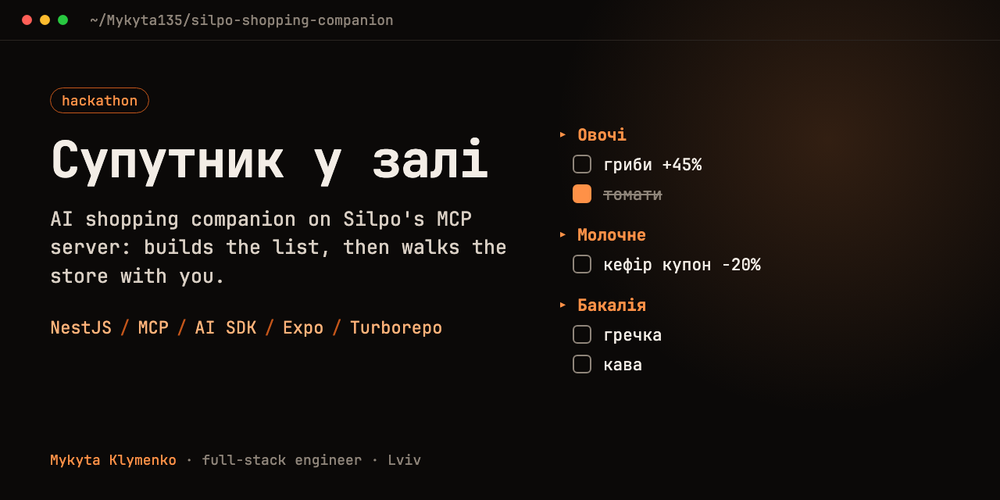

**In English.** An in-store shopping companion built on the official MCP server of Silpo, a Ukrainian grocery chain, for the Silpo AI Factory hackathon (2026). It reads the shopper's real offline receipts, spots what got more expensive and which coupons actually fit, builds a list where every item carries a reason, and orders it by store zones along the walking route. In the store it reacts to what's ahead, at most one remark per zone, and it can fill the real Silpo cart but never places the order itself.

Stack: NestJS 11 + `@modelcontextprotocol/sdk` + Vercel AI SDK (Claude) on the API, Expo / React Native app, Turborepo, shared types. 136 API tests (`npm test -w apps/api`). The rest of this README and the product docs are in Ukrainian.

---

# «Супутник у залі» — Silpo AI Factory

> Магазин спроєктований, щоб ти ходив довше. Цей агент — щоб ти пройшов один раз.

AI-помічник для покупок **у торговому залі**, побудований на офіційному
**MCP-сервері «Сільпо»** (`https://mcp.silpo.ua/mcp`). Агент читає реальні
офлайн-чеки, знаходить що подорожчало і які купони справді підходять гостю,
складає список і групує його **за зонами магазину в порядку обходу**.

Продуктова документація, дослідження та матеріали для пітчу — у **[docs/](docs/)**.

```
silpo-hackathon/
├── apps/
│   ├── api/        NestJS 11 — MCP-клієнт, OAuth 2.1 + PKCE, агентні сценарії
│   └── mobile/     Expo SDK 57 / RN 0.86 — список і супутник у залі
└── packages/
    └── shared/     Спільні типи
```

## Як це працює

### Фаза 1 — до магазину: гібридне складання списку

Агент пропонує, гість править. Кожна позиція несе **причину**:

| Джерело | Приклад причини |
| --- | --- |
| `rhythm` | «береш кожні ~10 днів, минулого разу 23.05» |
| `coupon` | «купон згорає через 2 дні» |
| `price` | «подорожчало на 30%, ось заміна» |
| `discovery` | «пасує твоєму раціону, ще не брав» |
| `guest` | «ти додав сам» |

### Фаза 2 — у залі: реактивний агент з пам'яттю обходу

Гість викреслює позиції; кожне викреслення — подія, на яку агент **може**
відреагувати. Мовчання — стан за замовчуванням: не більше однієї репліки
на зону, інакше продукт перетворюється на ті самі попапи, від яких він рятує.

Агент бачить **весь обхід**, а не окремий тап: скільки зібрано, скільки коштує
кошик зараз, які зони позаду, що вже взято. Тому він реагує на те, що **попереду**:

> «До речі, гриби з твого списку теж тут, в овочах — але подорожчали на 45%»

### Кошик

`POST /shopping/cart` записує обрані товари в **реальний кошик «Сільпо»** і
повертає checkout-посилання. Агент **ніколи не оформлює замовлення сам**.

Дві речі, які легко зробити неправильно:

- **Вагові товари** мають `step` (0.5 кг, 0.6 кг…). Замовлення «1» для лотка
  філе з кроком 0.6 означає **цілий кілограм** — перевірено на живому кошику.
- **Викреслити в залі ≠ купити.** Купон гасне від `inCart`, а не від `picked`.

Блокери кошика (прострочений слот, брак товару, мінімальна сума) перекладаються
на людську мову — без них гість бачив би «додано 7» і не розумів, чому немає
кнопки оформлення.

### Розподіл праці: код рахує, модель формулює

Ціни, інтервали покупок і дедлайни купонів — арифметика, і модель, яку
просять рахувати по сирих чеках, тихо помиляється. Тому всі числа
приходять до неї **готовими**; її робота — судження: чи пасує купон
цьому раціону, чи доречна заміна, чи варто взагалі озиватись.

## Аналітичні модулі

| Модуль | Що робить |
| --- | --- |
| [zones.ts](apps/api/src/shopping/zones.ts) | Категорія → зона → порядок обходу |
| [price-history.ts](apps/api/src/shopping/price-history.ts) | Персональна інфляція з `catalogProduct.price` |
| [rhythm.ts](apps/api/src/shopping/rhythm.ts) | Ритм покупок і що закінчується |
| [coupons.ts](apps/api/src/shopping/coupons.ts) | Дедлайни, ранжування, звірка з раціоном |
| [receipts.ts](apps/api/src/shopping/receipts.ts) | Розбір чеків, фільтр за датою |

## Стек

| Компонент | Версія |
| --- | --- |
| NestJS | 11.1.28 |
| React Native | 0.86.2 (Expo SDK 57) |
| MCP TypeScript SDK | 1.30.0 |
| Vercel AI SDK | 7.0.57 |
| Turborepo / Node | 2.10.9 / ≥22 |

## Запуск

```bash
npm install

cp apps/api/.env.example apps/api/.env        # додати ANTHROPIC_API_KEY
cp apps/mobile/.env.example apps/mobile/.env

npm run build
npm run dev            # api на :3010, Expo bundler
```

## Архітектура

```
Expo app  ──HTTP──▶  NestJS API  ──MCP (Streamable HTTP)──▶  mcp.silpo.ua
 sessionId            MCP-токен                                39 tools
 (непрозорий)         (тільки серверно)
```

Мобільний клієнт **ніколи** не отримує MCP-токен — лише непрозорий `sessionId`.
Це вимога хакатону («зберігати токени серверно, а не в клієнтському коді»).

### Авторизація

1. Клієнт викликає `GET /auth/silpo/status?sessionId=…`
2. Якщо не авторизовано — API проводить OAuth discovery + Dynamic Client
   Registration + PKCE і повертає `authorizationUrl`
3. Гість логіниться на `auth.silpo.ua`, «Сільпо» редіректить на
   `GET /auth/silpo/callback`, код обмінюється на токен
4. Токени зберігаються серверно ([token-store.ts](apps/api/src/mcp/token-store.ts))

### Агент

[mcp-tools.factory.ts](apps/api/src/agent/mcp-tools.factory.ts) читає живий
список інструментів через `tools/list` і мостить кожен в AI SDK через
`dynamicTool` — без хардкоду схем.

Структурований вивід — через `submit`-інструмент з Zod-схемою
([shopping.schemas.ts](apps/api/src/shopping/shopping.schemas.ts)), а не
`generateObject`: так лишається доступним багатокроковий цикл викликів.

## API

| Метод | Шлях | Призначення |
| --- | --- | --- |
| `GET` | `/auth/silpo/status?sessionId=` | Стан авторизації або URL логіну |
| `GET` | `/auth/silpo/callback` | OAuth 2.1 redirect |
| `GET` | `/shopping/zones` | Каталог зон магазину |
| `POST` | `/shopping/list` | Фаза 1: агент складає список |
| `GET` | `/shopping/list?sessionId=` | Поточний список + маршрут |
| `PATCH` | `/shopping/list` | Гість додає/прибирає позицію |
| `POST` | `/shopping/event` | Фаза 2: подія в залі → реакція агента |
| `POST` | `/shopping/cart` | Записати обране в кошик «Сільпо» + checkout |
| `DELETE` | `/shopping/list?sessionId=` | Скинути список |
| `POST` | `/agent/chat` | Вільний чат (запасний сценарій) |

## Режим демо

```bash
DEMO_MODE=true       # в apps/api/.env
```

Замінює **лише виклик моделі** заготовленою відповіддю
([demo.fixtures.ts](apps/api/src/shopping/demo.fixtures.ts)). Виклики MCP
лишаються справжніми — чеки, ціни й купони на екрані реальні.

Навіщо:

- **Детерміновано** — однаковий результат щоразу, пітч можна відрепетирувати
- **Швидко** — 1–2 с замість 60–90 с
- **Безкоштовно** й не залежить від балансу API чи мережі на презентації

## Команди

```bash
npm run dev          # всі застосунки
npm run build
npm run typecheck
npm run test
```

## Перевірено

- **OAuth discovery, DCR і PKCE (S256)** проти живого сервера «Сільпо»
- **Детермінований ланцюжок на реальному акаунті**: 7 MCP-викликів поспіль —
  контекст кошика → офлайн-чеки → купони + деталі → інфляція → маршрут
- **Повний агентний цикл із моделлю** на живому акаунті: фаза 1 склала список
  з причинами, фаза 2 відреагувала на купон, знайшла заміну через каталог
  (3 виклики tools) і **промовчала**, коли вже говорила в цій зоні
- **Ритм покупок** — на синтетичній історії з 75 чеків середня похибка **4%**
- **Запис у реальний кошик «Сільпо»** — 7 товарів, 558 ₴, купон на сир
  застосувався автоматично (67.99 → 1 ₴)
- API піднімається з усіма роутами; **136 тестів** проходять
- Metro бандлить Expo-застосунок; UI перевірено в браузері

## Відоме обмеження

`inCart` не скидається, якщо гість видалить товар у застосунку «Сільпо» —
наш список вважатиме, що товар там. Виправляється звіркою кошика при
завантаженні списку; для демо не критично, для продакшену обов'язково.

## Нотатки для продакшену

- `TokenStore` і `ListStore` — файлові (mode `0600`, gitignored). Інтерфейс
  навмисно вузький (`get`/`save`/`mutate`), тож заміна на Postgres торкається
  одного файлу. Своїх даних майже немає — усе тягнеться з «Сільпо» через MCP.
- `sessionId` поки не автентифікований — прив'язати до реальної сесії
  користувача перед будь-яким виходом за межі демо.
- Порядок зон — **модель типового магазину**, а не планограма конкретного.
  Подавати як розумний маршрут, не як точну навігацію.
